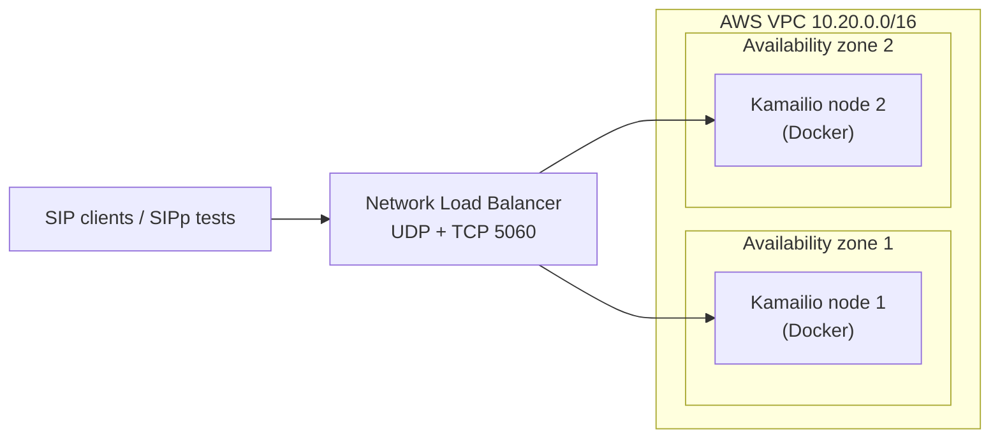

# Voice Core Lab: an IMS-style SIP core on Docker and AWS

A small voice-call core built and tested the way a delivery project is: infrastructure as code,
containerised deployment, automated system and acceptance tests, a CI pipeline, and written
documentation. It runs locally with Docker Compose and deploys to AWS across two availability zones.

> **Scope, stated plainly.** This is a learning lab built from open-source software (Kamailio and SIPp).
> It is **IMS-style**, not an Ericsson product and not a full IMS core. The table below says exactly
> which parts exist and which do not.

## Architecture



Locally, the same Kamailio image runs next to a SIPp test container on a Docker network.

## What maps to what

| Role in an IMS-style voice network | In this lab |
|---|---|
| Call session control (registrar and proxy, CSCF-like) | Kamailio, combined into one role |
| Subscriber store (HSS-like) | In-memory location table only. Not a real HSS |
| Session border control and media (SBC / MRF-like) | **Not implemented** (roadmap: RTPengine) |
| DNS / ENUM number resolution | **Not implemented** (roadmap) |
| Telephony application server (TAS-like) | **Not implemented** |
| Virtualised infrastructure (NFVI-like) | EC2 + Docker in a multi-AZ VPC behind a Network Load Balancer |

## Quick start (local, about 10 minutes)

You need Docker with the Compose plugin.

```bash
docker compose up --build --abort-on-container-exit --exit-code-from tests
cat results/summary.txt
```

Expected output is three `PASS` lines (S1, S2, A1). Logs for each test are in `results/`.
To run only some tests: `TESTS="options register" docker compose run --rm --no-deps tests`.

If the Kamailio image fails to build, the error comes from `kamailio -c` and tells you the line to fix.
To watch Kamailio while the tests run: `docker compose logs -f kamailio`.

## Deploy to AWS (about 20 minutes, costs a few cents per hour)

You need an AWS account, the AWS CLI configured, and Terraform 1.5 or newer.
Push this repo to a **public** GitHub repo first, because the servers clone it at boot.

```bash
cd terraform
terraform init
terraform apply \
  -var 'allowed_cidr=YOUR.PUBLIC.IP/32' \
  -var 'repo_url=https://github.com/YOUR-USER/voice-core-lab.git'
```

Terraform prints `nlb_dns_name`. Wait about 3 minutes for the nodes to boot and pass health checks, then
test through the load balancer from your machine (registration and OPTIONS work from anywhere; full calls
need both phones to be reachable, so run those inside the VPC):

```bash
TARGET=<nlb_dns_name> TESTS="options register" docker compose run --rm --no-deps tests
```

**Always clean up:** `terraform destroy` with the same `-var` values.

## Design decisions

- **Two availability zones, one node each.** A single zone failure leaves one node serving traffic.
- **Network Load Balancer, not an application load balancer.** SIP runs over UDP and TCP, which an NLB handles.
- **Public subnets, no NAT gateway.** This keeps the lab cheap. Access is limited by a security group to your IP,
  and there is no SSH port: operators use AWS Session Manager. A production design would use private subnets
  with NAT and a session border controller at the edge.
- **Everything in code.** Terraform for the infrastructure, Dockerfiles for the software, GitHub Actions for checks.
- **Host networking on EC2.** SIP is simpler without Docker's port translation.

## Limitations

- No authentication or TLS. Do not expose it to the internet beyond your own IP.
- Registrations are in memory on each node. After a node fails, clients must register again. A real core
  would use a shared store.
- No media relay, so calls only work where both phones can reach each other directly.
- Failover is demonstrated by hand (see `docs/test-plan.md`), not automated.

## Roadmap

1. RTPengine for media relay and NAT handling.
2. ENUM and number resolution with a small DNS zone.
3. Shared registration store (database-backed) so failover keeps registrations.
4. TLS and digest authentication.
5. Metrics and dashboards with Prometheus and Grafana.

## Tests

See [docs/test-plan.md](docs/test-plan.md) for the module, system and acceptance tests and how to run them.
